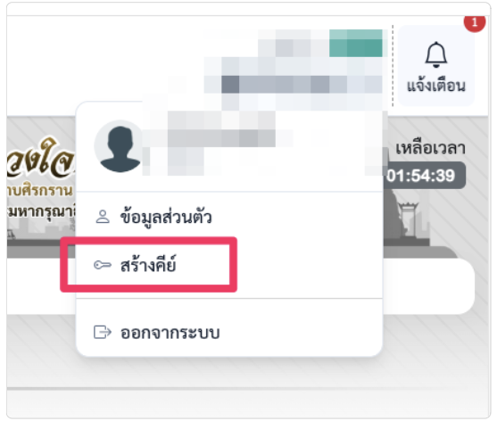
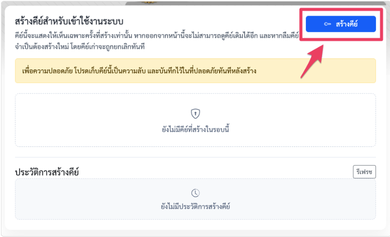
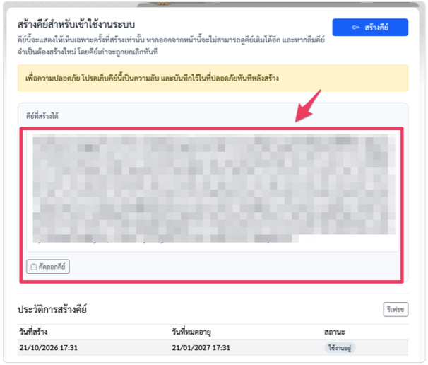

# การส่งข้อมูล 43 แฟ้มผ่าน API

สำหรับหน่วยบริการที่ต้องการส่งไฟล์ 43 แฟ้มเข้าสู่ระบบ HDC โดยใช้คำสั่ง (Command Line / Script) แทนการอัปโหลดผ่านหน้าเว็บไซต์

## ภาพรวมขั้นตอน

1. **สร้างคีย์ (API Key)** จากหน้าเว็บไซต์ HDC
2. **คัดลอกคีย์** ไปเก็บรักษาไว้ในที่ปลอดภัย
3. **เรียกใช้งาน API** โดยใช้คีย์เพื่อส่งไฟล์ `.zip` ข้อมูล 43 แฟ้ม

---

## ขั้นที่ 1: เปิดเมนูสร้างคีย์

เข้าสู่ระบบ HDC ตามปกติ จากนั้นคลิกที่ **ชื่อผู้ใช้งาน** บริเวณมุมขวาบน แล้วเลือกเมนู **สร้างคีย์**



---

## ขั้นที่ 2: กดปุ่มสร้างคีย์

ในหน้า **สร้างคีย์สำหรับเข้าใช้งานระบบ** ให้คลิกปุ่ม **สร้างคีย์** บริเวณมุมขวาบน



!!! warning "ข้อควรระวังสำคัญ"
    คีย์จะแสดงให้เห็นเพียงครั้งเดียวตอนที่กดสร้างเท่านั้น หากออกจากหน้านี้ไปแล้วจะไม่สามารถกลับมาดูคีย์เดิมได้อีก กรณีที่ลืมคีย์จำเป็นต้องกดสร้างคีย์ใหม่ ซึ่งจะส่งผลให้คีย์เก่าถูกยกเลิกและใช้งานไม่ได้ทันที

---

## ขั้นที่ 3: คัดลอกและเก็บรักษาคีย์

เมื่อระบบสร้างคีย์เสร็จสิ้น รหัสคีย์จะแสดงในกรอบ **คีย์ที่สร้างได้** ให้คลิกปุ่ม **คัดลอกคีย์** แล้วนำไปบันทึกเก็บไว้ในที่ปลอดภัยทันที



* **อายุการใช้งาน:** ด้านล่างจะมีตาราง **ประวัติการสร้างคีย์** แสดงวันที่สร้าง วันหมดอายุ และสถานะ โดยคีย์จะมีอายุการใช้งานประมาณ **3 เดือน** (เช่น สร้างวันที่ `21/10/2026` จะหมดอายุวันที่ `21/01/2027`) เมื่อใกล้ครบกำหนดให้เข้ามาสร้างคีย์ใหม่

!!! danger "การรักษาความปลอดภัย"
    ห้ามส่งคีย์ให้ผู้อื่น ห้ามโพสต์ลงในกลุ่มแชท และห้ามบันทึกไว้ในไฟล์ที่บุคคลอื่นสามารถเปิดอ่านได้ เนื่องจากผู้ที่มีคีย์จะสามารถส่งข้อมูลเข้าสู่ระบบในนามหน่วยบริการของท่านได้ทันที

---

## ขั้นที่ 4: ส่งไฟล์ผ่าน API

### รายละเอียดการเชื่อมต่อ (API Endpoint)

* **URL:** `https://api-center-hdc.moph.go.th/v1/api/upload/upload43`
* **Method:** `POST`
* **Header:** `Authorization: Bearer <คีย์ของท่าน>`
* **รูปแบบข้อมูล (Content-Type):** `multipart/form-data`
* **ชื่อฟิลด์ไฟล์ (Field Name):** `files`
* **ไฟล์ที่ส่ง:** ไฟล์ `.zip` มาตรฐาน 43 แฟ้มที่ส่งออกจากโปรแกรมของหน่วยบริการ (เช่น `F43_12345_25690101120000_1700000000000.zip`)

### ตัวอย่างคำสั่งบน macOS หรือ Linux

```bash
curl --request POST \
  --url [https://api-center-hdc.moph.go.th/v1/api/upload/upload43](https://api-center-hdc.moph.go.th/v1/api/upload/upload43) \
  --header 'Authorization: Bearer YOUR_API_KEY' \
  --header 'Content-Type: multipart/form-data' \
  --form files=@/Users/name-u/Downloads/F43_12345_25690101120000_1700000000000.zip
```

### ตัวอย่างคำสั่งบน Windows (Command Prompt)

```cmd
curl --request POST ^
  --url [https://api-center-hdc.moph.go.th/v1/api/upload/upload43](https://api-center-hdc.moph.go.th/v1/api/upload/upload43) ^
  --header "Authorization: Bearer YOUR_API_KEY" ^
  --header "Content-Type: multipart/form-data" ^
  --form files=@C:\Users\name-u\Downloads\F43_12345_25690101120000_1700000000000.zip
```

### วิธีแก้ไขคำสั่งก่อนนำไปใช้งาน

1. แทนที่คำว่า `YOUR_API_KEY` ด้วยคีย์ที่คัดลอกไว้ในขั้นที่ 3 (ต้องเว้นวรรค 1 เคาะหลังคำว่า `Bearer`)
2. แก้ไขที่อยู่ไฟล์ (Path) หลังเครื่องหมาย `@` ให้ตรงกับตำแหน่งไฟล์ `.zip` ในเครื่องของท่าน
3. หากชื่อโฟลเดอร์หรือที่อยู่ไฟล์มีช่องว่าง (Space) ให้ใส่เครื่องหมายคำพูด (`"..."`) ครอบทั้งค่า เช่น `--form "files=@C:\My Files\F43.zip"`

---

## ตัวอย่างการส่งด้วย Python (แบบไม่สร้างไฟล์ลงเครื่อง)

เหมาะสำหรับระบบอัตโนมัติที่ดึงข้อมูลจากฐานข้อมูลแล้วส่งต่อทันที โดยตัวโปรแกรมจะบีบอัดสร้างไฟล์ `.zip` ไว้ในหน่วยความจำ (In-Memory) แล้วส่งขึ้น API โดยตรง ทำให้ไม่มีไฟล์ตกค้างในเครื่องเซิร์ฟเวอร์

### 1. ติดตั้งไลบรารี (ทำครั้งเดียว)

```bash
pip install requests
```

### 2. โค้ดโปรแกรม (`upload43.py`)

```python
import io
import os
import zipfile
import requests

API_URL = "[https://api-center-hdc.moph.go.th/v1/api/upload/upload43](https://api-center-hdc.moph.go.th/v1/api/upload/upload43)"

# อ่านคีย์จาก Environment Variable เพื่อความปลอดภัย (ไม่ควรเขียนคีย์ไว้ในโค้ดโดยตรง)
API_KEY = os.environ["HDC_API_KEY"]

# ข้อมูลแต่ละแฟ้ม (ในงานจริงให้ดึงข้อมูลจากฐานข้อมูลของหน่วยบริการ)
# ตัวอย่างนี้เป็นข้อมูลสมมติ
files_43 = {
    "PERSON.txt": "HOSPCODE|CID|PID|...\n12345|1111111111111|1|...\n",
    "SERVICE.txt": "HOSPCODE|PID|SEQ|...\n12345|1|1|...\n",
}

# สร้างไฟล์ zip ในหน่วยความจำ (Memory Buffer)
buffer = io.BytesIO()
with zipfile.ZipFile(buffer, "w", zipfile.ZIP_DEFLATED) as zf:
    for name, content in files_43.items():
        zf.writestr(name, content)
buffer.seek(0)

# ชื่อไฟล์ zip ที่จะแจ้งให้ระบบทราบ (ใช้รูปแบบเดียวกับไฟล์ที่ส่งออกจากโปรแกรม)
zip_name = "F43_12345_25690101120000_1700000000000.zip"

response = requests.post(
    API_URL,
    headers={"Authorization": f"Bearer {API_KEY}"},
    files={"files": (zip_name, buffer, "application/zip")},
    timeout=300,
)

print(response.status_code)
print(response.text)
```

### 3. วิธีสั่งรันโปรแกรม

**บน macOS หรือ Linux:**

```bash
export HDC_API_KEY="YOUR_API_KEY"
python upload43.py
```

**บน Windows (Command Prompt):**

```cmd
set HDC_API_KEY=YOUR_API_KEY
python upload43.py
```

### ข้อสังเกตเพิ่มเติมสำหรับนักพัฒนา

* **Header `Content-Type`:** ไม่ต้องกำหนดค่าเอง เนื่องจากไลบรารี `requests` จะสร้าง `multipart/form-data` พร้อมตั้งค่า `boundary` ให้อัตโนมัติเมื่อส่งผ่านพารามิเตอร์ `files=`
* **ชื่อฟิลด์:** ต้องระบุเป็น `"files"` เหมือนกับในคำสั่ง `curl`
* **กรณีมีข้อมูลเป็น Bytes อยู่แล้ว:** หากรับไฟล์ `.zip` มาจากระบบอื่นในรูปแบบ `bytes` ในหน่วยความจำแล้ว สามารถข้ามขั้นตอนการสร้าง `zipfile` และส่ง `io.BytesIO(ข้อมูล_bytes)` แทนตัวแปร `buffer` ได้ทันที
* **โครงสร้างข้อมูล:** รูปแบบข้อมูลในแต่ละแฟ้มต้องยึดตามโครงสร้างมาตรฐาน 43 แฟ้มฉบับที่ใช้งานอยู่ (โค้ดด้านบนเป็นการย่อเพื่อให้เข้าใจง่ายเท่านั้น)

---

## ขั้นที่ 5: ตรวจสอบผลการส่งและการแก้ไขปัญหา

หลังจากสั่งรันคำสั่ง ระบบจะแสดงผลลัพธ์ตอบกลับทางหน้าจอ ให้ตรวจสอบข้อความหรือรหัสสถานะ (HTTP Status Code) เพื่อยืนยันว่าส่งไฟล์สำเร็จ

* **ไม่มีสิทธิ์เข้าถึง (`401` หรือ `403`):** เกิดจากคีย์ไม่ถูกต้อง คีย์หมดอายุ หรือมีการกดสร้างคีย์ใหม่ทำให้คีย์เก่าถูกยกเลิก ให้ตรวจสอบความถูกต้องของคีย์ หรือทำการสร้างคีย์ใหม่
* **แจ้งเตือนว่าหาไฟล์ไม่เจอ:** ที่อยู่ไฟล์ (Path) หลังเครื่องหมาย `@` ไม่ถูกต้อง ให้ตรวจสอบชื่อโฟลเดอร์และชื่อไฟล์อีกครั้ง (ระวังเรื่องช่องว่างในชื่อโฟลเดอร์)
* **ไม่พบคำสั่ง `curl`:** ระบบปฏิบัติการ Windows 10 ขึ้นไปจะมีคำสั่ง `curl` ติดตั้งมาให้พร้อมใช้งานแล้ว หากเป็น Windows รุ่นเก่ากว่าจำเป็นต้องดาวน์โหลดและติดตั้งเพิ่มเติม

---

## สรุปข้อควรจำ

* **คีย์ดูได้เพียงครั้งเดียว** ต้องกดคัดลอกและบันทึกเก็บไว้ทันทีหลังสร้าง
* **เมื่อสร้างคีย์ใหม่ คีย์เก่าจะถูกยกเลิกทันที** ต้องนำไปอัปเดตเปลี่ยนคีย์ในทุกเครื่องหรือทุกสคริปต์ที่ใช้ส่งข้อมูล
* **คีย์มีวันหมดอายุ** สามารถตรวจสอบวันหมดอายุได้จากตาราง **ประวัติการสร้างคีย์**
* **เก็บรักษาคีย์ไว้เป็นความลับ** ห้ามส่งต่อหรือเผยแพร่ให้บุคคลอื่นโดยเด็ดขาด