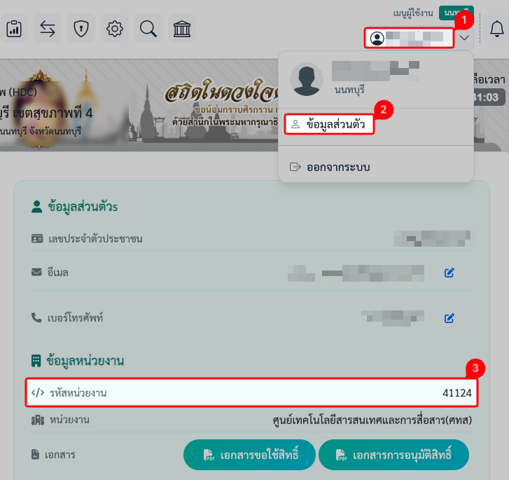
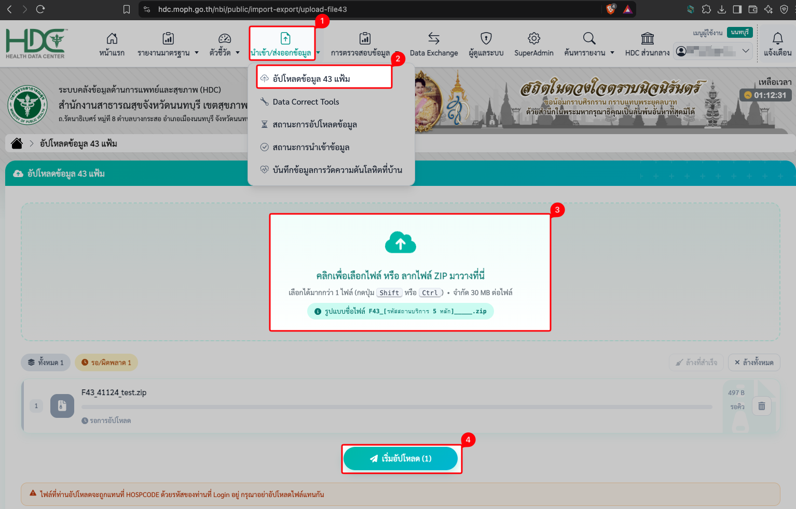
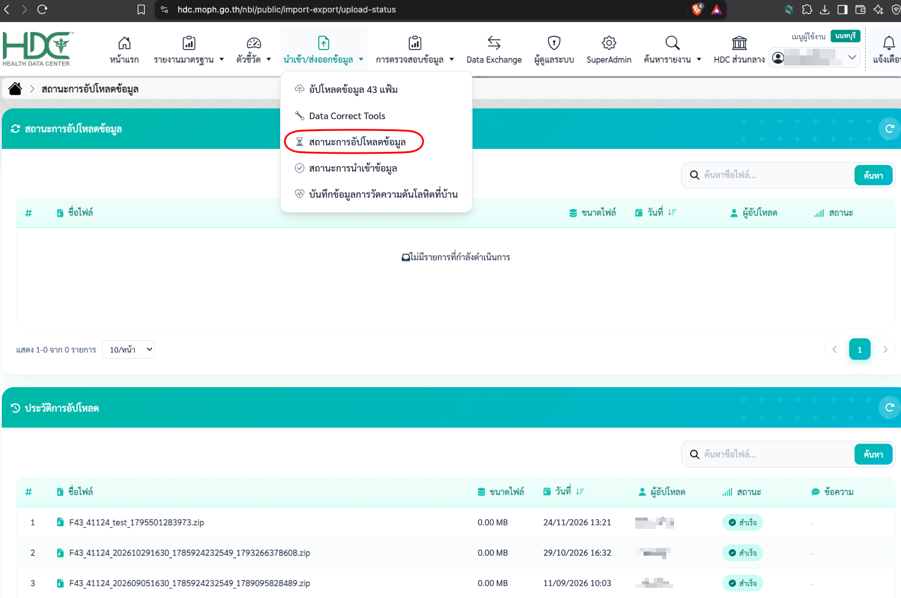
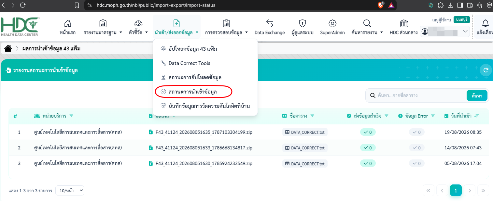

# การอัปโหลดข้อมูล 43 แฟ้ม

ขั้นตอนการนำส่งและอัปโหลดไฟล์ข้อมูลมาตรฐาน 43 แฟ้มเข้าสู่ระบบคลังข้อมูลด้านการแพทย์และสุขภาพ (HDC) สำหรับเจ้าหน้าที่และผู้รับผิดชอบงานข้อมูลของสถานบริการ

---

## สิ่งที่ต้องเตรียมก่อนการอัปโหลด
1. **ไฟล์ข้อมูลมาตรฐาน 43 แฟ้ม** ที่ผ่านการตรวจสอบความถูกต้องเรียบร้อยแล้ว
2. **การบีบอัดไฟล์ (Compression):** ต้องทำการบีบอัดไฟล์ให้อยู่ในรูปแบบ **ZIP file (`.zip`)** เท่านั้น
3. **โครงสร้างการตั้งชื่อไฟล์:** ระบบกำหนดรูปแบบการตั้งชื่อไฟล์เป็นสากล ดังนี้
   `F43_xxxxx_YYYYMMDDHHmmss.zip`
    * **xxxxx**: รหัสสถานบริการ 5 หลัก
    * **YYYYMMDDHHmmss**: ปี เดือน วัน และเวลาที่ส่งข้อมูล
4. **ขนาดไฟล์:** จำกัดขนาดไฟล์ในการอัปโหลดสูงสุดไม่เกิน **30MB ต่อไฟล์**

!!! example "ตัวอย่างชื่อไฟล์"
    `F43_41124_20250325144500.zip`

---

## กรณีหน่วยบริการใหม่ (มีเฉพาะรหัสหน่วยบริการ 9 หลัก)

สำหรับหน่วยบริการเปิดใหม่ที่ได้รับจัดสรรเฉพาะ **รหัสหน่วยบริการ 9 หลัก** และยังไม่มีรหัส 5 หลัก หากต้องการส่งข้อมูลมาตรฐาน 43 แฟ้มเข้าสู่ระบบ HDC ให้ดำเนินการตามขั้นตอนดังนี้

### 1. แจ้งความประสงค์และสมัครใช้งานระบบ HDC
ให้ดำเนินการตามขั้นตอนการขอส่งข้อมูล (ข้อ 1 – 4 ในภาพด้านล่าง) โดย **เปลี่ยนจากการระบุรหัสหน่วยบริการ 5 หลัก เป็นรหัสหน่วยบริการ 9 หลัก** แทน

1. **แจ้งความประสงค์ขอส่งข้อมูลบนระบบ HDC:** หน่วยบริการจัดทำและส่งหนังสือราชการ โดยระบุ **รหัสหน่วยบริการ 9 หลัก** ส่งไปยังกองยุทธศาสตร์และแผนงาน สำนักงานปลัดกระทรวงสาธารณสุข (กยผ.สป.)
2. **เช็คสถานะการส่งข้อมูล:** ตรวจสอบสถานะได้ที่ [https://hcode.moph.go.th/code](https://hcode.moph.go.th/code) โดยกรอก **รหัสหน่วยบริการ 9 หลัก** แล้วเปิดดูไฟล์ `PDF: ส่ง HDC`
3. **หน่วยบริการสมัครใช้งาน HDC:** ลงทะเบียนสมัครใช้งานระบบ HDC ของจังหวัดตนเอง (`https://hdc.moph.go.th/xxx`) โดยใช้รหัสหน่วยบริการ 9 หลัก
4. **รอแอดมินจังหวัดอนุมัติ:** เมื่อผู้ดูแลระบบ (Admin) ระดับจังหวัดอนุมัติสิทธิ์เรียบร้อยแล้ว จึงจะสามารถเข้าสู่ระบบเพื่อดำเนินการส่งข้อมูลได้

---

### 2. ตรวจสอบรหัสหน่วยบริการ 5 หลักในระบบ HDC
เมื่อได้รับอนุมัติสิทธิ์และเข้าสู่ระบบ HDC เรียบร้อยแล้ว ระบบจะสร้างรหัสอ้างอิง 5 หลักให้อัตโนมัติ สามารถตรวจสอบรหัสหน่วยบริการ 5 หลักได้ตามขั้นตอนดังนี้

1. คลิกที่ **ชื่อผู้ใช้งาน** บริเวณเมนูมุมขวาบน
2. เลือกเมนู **ข้อมูลส่วนตัว**
3. ดูที่หัวข้อ **ข้อมูลหน่วยงาน** ในช่อง **รหัสหน่วยงาน** จะปรากฏรหัสหน่วยบริการ 5 หลัก (เช่น `41124`) เพื่อนำไปใช้อ้างอิงในการเตรียมไฟล์ข้อมูล

---

### 3. ข้อควรระวังในการเตรียมไฟล์และอัปโหลดข้อมูล

!!! warning "ข้อกำหนดสำคัญสำหรับการตั้งชื่อไฟล์และข้อมูลภายใน"
    แม้ว่าขั้นตอนการขอสิทธิ์และลงทะเบียนจะใช้รหัส 9 หลัก แต่ในขั้นตอนการส่งออกและอัปโหลดไฟล์ข้อมูล 43 แฟ้มเข้าสู่ระบบ HDC **ต้องใช้รหัสหน่วยบริการ 5 หลัก ที่ตรวจสอบได้จากข้อ 2 เท่านั้น**

* **การตั้งชื่อไฟล์ (File Name):** ต้องระบุเป็น **รหัสหน่วยบริการ 5 หลัก** ตามรูปแบบมาตรฐาน (เช่น `F43_41124_20261124.zip`) ห้ามใช้รหัส 9 หลักในการตั้งชื่อไฟล์
* **ข้อมูลภายในไฟล์ (HOSPCODE):** ค่าในคอลัมน์ `HOSPCODE` ของทุกแฟ้มข้อมูล ต้องระบุเป็น **รหัสหน่วยบริการ 5 หลัก เท่านั้น** หากใช้รหัส 9 หลัก ระบบจะปฏิเสธการนำเข้าหรือประมวลผลข้อมูลผิดพลาด

---

## ขั้นตอนการอัปโหลดข้อมูล

เมื่อเข้าสู่ระบบ HDC เรียบร้อยแล้ว ให้ดำเนินการอัปโหลดไฟล์ข้อมูล 43 แฟ้ม ตามลำดับหมายเลขในภาพดังนี้

1. คลิกที่เมนู **นำเข้า/ส่งออกข้อมูล** บริเวณแถบเมนูด้านบน
2. เลือกเมนูย่อย **อัปโหลดข้อมูล 43 แฟ้ม**
3. คลิกที่พื้นที่อัปโหลด (**คลิกเพื่อเลือกไฟล์ หรือ ลากไฟล์ ZIP มาวางที่นี่**) เพื่อเลือกไฟล์ `.zip` ที่เตรียมไว้
    * สามารถเลือกได้มากกว่า 1 ไฟล์พร้อมกัน (โดยกดปุ่ม `Shift` หรือ `Ctrl` ค้างไว้)
    * ขนาดไฟล์จำกัดไม่เกิน **30 MB ต่อไฟล์**
    * รูปแบบชื่อไฟล์ต้องขึ้นต้นด้วย `F43_[รหัสสถานบริการ 5 หลัก]____.zip` (เช่น `F43_41124_test.zip`)
4. ตรวจสอบรายการไฟล์ที่แสดงด้านล่าง (สถานะ *รอการอัปโหลด*) จากนั้นคลิกปุ่ม **เริ่มอัปโหลด** เพื่อส่งข้อมูลเข้าสู่ระบบ

!!! danger "ข้อควรระวังในการอัปโหลด"
    ระบบจะทำการแทนที่ค่า `HOSPCODE` ภายในไฟล์ที่อัปโหลดด้วย **รหัสหน่วยบริการ 5 หลัก ของบัญชีที่กำลัง Login อยู่ในขณะนั้น** โดยอัตโนมัติ **ห้ามใช้บัญชีของหน่วยบริการอื่นอัปโหลดไฟล์แทนกันโดยเด็ดขาด**

---

## การตรวจสอบสถานะการอัปโหลด

หลังจากทำการอัปโหลดไฟล์ข้อมูลเรียบร้อยแล้ว สามารถติดตามสถานะการส่งไฟล์ได้ตามขั้นตอนดังนี้

1. คลิกที่เมนู **นำเข้า/ส่งออกข้อมูล** บริเวณแถบเมนูด้านบน
2. เลือกเมนูย่อย **สถานะการอัปโหลดข้อมูล**
3. ระบบจะแสดงหน้าจอตรวจสอบข้อมูลแบ่งออกเป็น 2 ส่วนหลัก ได้แก่
    * **สถานะการอัปโหลดข้อมูล (ตารางบน):** แสดงรายการไฟล์ที่กำลังอยู่ระหว่างดำเนินการส่งเข้าสู่ระบบ
    * **ประวัติการอัปโหลด (ตารางล่าง):** แสดงรายการไฟล์ที่ดำเนินการอัปโหลดเสร็จสิ้นแล้ว พร้อมรายละเอียดชื่อไฟล์ ขนาดไฟล์ วันที่อัปโหลด ชื่อผู้อัปโหลด สถานะ (เช่น `สำเร็จ`) และข้อความแจ้งเตือนจากระบบ

!!! tip "คำแนะนำเพิ่มเติม"
    * สามารถพิมพ์ชื่อไฟล์ในช่อง **ค้นหาชื่อไฟล์...** และกดปุ่ม **ค้นหา** เพื่อตรวจสอบรายการเฉพาะไฟล์ที่ต้องการได้
    * สามารถกดปุ่มรีเฟรช (ไอคอนลูกศรวนมุมขวาบนของแต่ละตาราง) เพื่ออัปเดตสถานะล่าสุดโดยไม่ต้องโหลดหน้าเว็บใหม่
    * เมื่อสถานะการอัปโหลดขึ้นเป็น **สำเร็จ** แล้ว ขั้นตอนถัดไปสามารถตรวจสอบผลการประมวลผลเข้าฐานข้อมูลได้ที่เมนู **สถานะการนำเข้าข้อมูล**

---

## ผลการนำเข้าข้อมูล 43 แฟ้ม

เมื่อไฟล์อัปโหลดเข้าสู่ระบบเรียบร้อยแล้ว สามารถตรวจสอบผลการประมวลผลและจำนวนระเบียน (Record) ที่นำเข้าสู่ฐานข้อมูลในแต่ละแฟ้มได้ตามขั้นตอนดังนี้

1. คลิกที่เมนู **นำเข้า/ส่งออกข้อมูล** บริเวณแถบเมนูด้านบน
2. เลือกเมนูย่อย **สถานะการนำเข้าข้อมูล**
3. ระบบจะแสดงตาราง **รายงานสถานะการนำเข้าข้อมูล** ซึ่งประกอบด้วยรายละเอียดสำคัญในแต่ละคอลัมน์ ดังนี้
    * **หน่วยบริการ:** ชื่อหน่วยบริการที่ส่งข้อมูล
    * **ชื่อไฟล์:** ชื่อไฟล์ `.zip` ที่ทำการอัปโหลด
    * **ชื่อตาราง:** ชื่อแฟ้มข้อมูลมาตรฐาน (เช่น `DATA_CORRECT.txt`, `PERSON.txt`, `SERVICE.txt` เป็นต้น)
    * **ส่งข้อมูลสำเร็จ:** จำนวนระเบียน (Record) ที่ระบบนำเข้าสู่ฐานข้อมูลได้สมบูรณ์
    * **ข้อมูล Error:** จำนวนระเบียนที่ไม่ผ่านการตรวจสอบตามโครงสร้างมาตรฐาน (หากมีค่ามากกว่า 0 ควรคลิกตรวจสอบเพื่อแก้ไขข้อมูลให้ถูกต้อง)
    * **วันที่นำเข้า:** วันและเวลาที่ระบบประมวลผลการนำเข้าข้อมูลเสร็จสิ้น

!!! tip "คำแนะนำเพิ่มเติม"
    * สามารถพิมพ์ชื่อแฟ้มในช่อง **ค้นหา...จากชื่อตาราง** และกดปุ่ม **ค้นหา** เพื่อกรองดูเฉพาะตารางข้อมูลที่ต้องการตรวจสอบได้
    * สามารถกดที่หัวคอลัมน์เพื่อเรียงลำดับข้อมูล (Sort) หรือกดปุ่มรีเฟรชบริเวณมุมขวาบนของตารางเพื่ออัปเดตสถานะการประมวลผลล่าสุด
